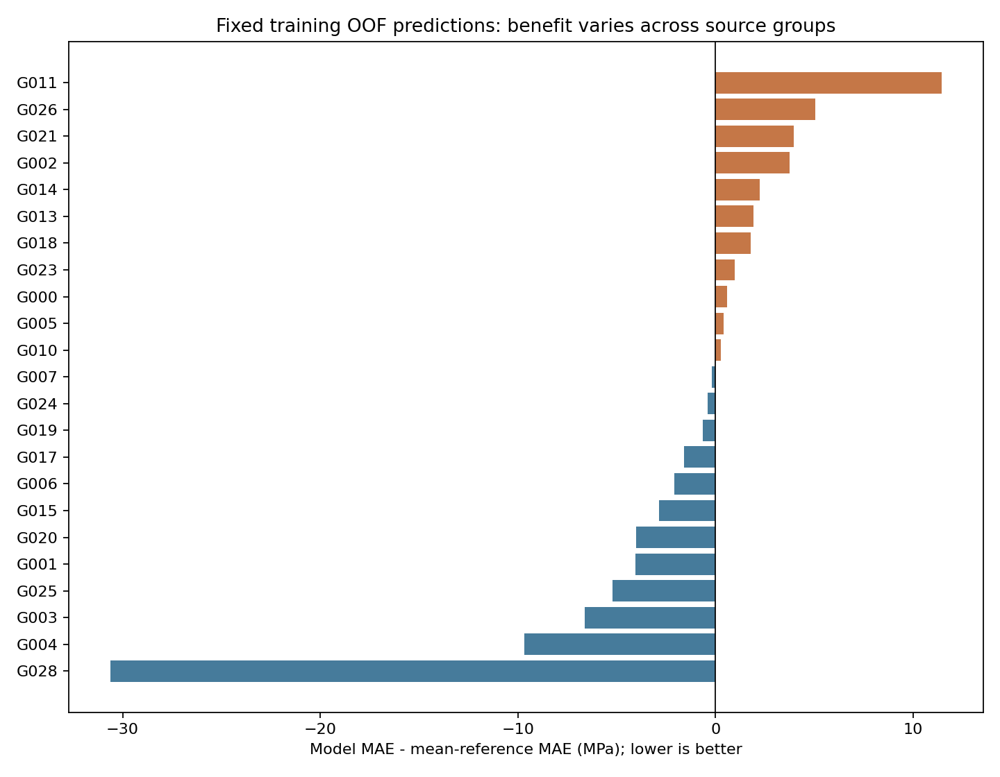

## 水下混凝土28天抗压强度预测：阶段性探索建模报告

日期：2026年10月24日。目的：说明已运行的建模流程、真实验证表现、来源稳定性和目前证据边界。本文不作为最终科研结论。

## 1. 当前进展与可支持的结论

已跑通只读导入、筛选与版本记录、缺失输入处理、RF/XGBoost/CatBoost训练、随机配合比簇与论文分组评价、残差和来源诊断、CSV批量预测。当前跨文献性能不稳定，尚不能支持可靠高精度泛化的结论。

原始Excel和强度标签未覆盖。数据及部分来源已经过多轮探索，不能把现有开发分数称作全新盲测。没有新增正式“已核实可用”样本。

## 2. 实际文件及数据范围

未找到《水下混凝土_人工核查版.xlsx》和《水下混凝土_筛选结果_20261012.xlsx》。实际读取原版UnderwaterConcrete - Total Data (Select 0927).xlsx；原版Selected、批注核对版及筛选方案是不同文件，不冒充缺失版本。

|项目|实际记录数|
|---|---|
|原版Total|1082|
|原表标为水下|710|
|水下Converted正值|582|
|有直接水下成型辅助证据的主集|212|
|扩展探索集（包含主集）|467|
|额外范围待核查|255|

主集成型范围有原文辅助核查支持，不等于整条数据或换算依据已正式人工核实。使用原表存储Converted CS_28d；0.95/0.8/0.76系数沿用用户许可的暂定规则。算术一致不证明可靠。已知非直接成型的30条单独隔离，未补造目标。

## 3. Baseline V1方法与真实结果

原材料11字段仅取配合比参数；Density、其他实测性能和目标派生变量未纳入。零值含义未明按未知，中位数与缺失指示器只在训练折拟合。固定参数、无搜索；划分前识别近重复配比，不按目标删样本。

|主集方案|模型|评价数|MAE/MPa|RMSE/MPa|R²|
|---|---|---|---|---|---|
|random_recipe_holdout|rf|42|4.387|6.438|0.784|
|random_recipe_holdout|xgb|42|4.185|5.405|0.848|
|random_recipe_holdout|catboost|42|3.974|5.291|0.854|
|paper_group_holdout|rf|95|12.206|15.171|-1.098|
|paper_group_holdout|xgb|95|8.942|11.297|-0.163|
|paper_group_holdout|catboost|95|9.507|11.799|-0.269|
|paper_group_cv|rf|212|7.171|11.822|0.160|
|paper_group_cv|xgb|212|7.060|12.423|0.072|
|paper_group_cv|catboost|212|8.225|13.489|-0.094|

随机划分按近重复配比簇隔离，但允许同文献不同配比跨集。论文留出按来源连通组隔离；两种划分的测试分布不同，差距不能全部归因于泄漏或过拟合。论文留出R²均为负，提示跨来源迁移困难。主集只有6个来源连通组，五折验证样本数也不均。

## 4. Baseline V1.1：仅训练集内部选择

锁定V1论文留出。本轮原有训练内比较只用主集117条/4来源组、扩展训练320条/23来源组；95/147条留出不再参与选方案或新评价。比较Water/Cem两字段与11字段、中位数与标准化KNN；按来源组平均MAE选候选。

|训练队列|候选|MAE/MPa|RMSE/MPa|R²|
|---|---|---|---|---|
|primary_direct|catboost / materials / scaled_knn|19.826|21.141|-1.109|
|exploratory_underwater|xgb / core / median|9.118|12.227|0.084|

主集训练只余4组，其中Nasr组104条，留该组验证时只有其他体系13条可训练，结果极不稳定。这些训练CV分数不能与V1全体五折直接比较。模型选择与报告复用了同一训练CV，仍可能乐观。

## 5. 本轮新增：固定折外预测的来源稳定性

扩展候选在23个来源连通组中，12组MAE优于均值参照，11组更差。对来源组进行2000次配对重采样、每次保留组内所有记录，既不重训练，也不挑测试集。

模型样本平均MAE为9.118 MPa，来源重采样2.5%–97.5%分位范围为7.430–11.435 MPa。来源宏平均MAE相对均值参照的差值范围为-4.907至1.081 MPa，跨过0，说明收益对来源构成敏感。

上述范围是固定训练折外误差的描述性稳定性诊断，不是独立测试置信区间，不是p值或泛化保证。它不包含重新拟合模型的全部不确定性，也不能消除多轮探索和选模偏差。

## 6. 文献证据缺口与数据语义

已整理4篇缺原文来源的26条记录。当前网络代理请求返回403，没有取得新PDF；题录、DOI、备注和单元格内容是原表线索，未冒充原文验证。

Zhongzhe Zhang 2023的747/751/755/759行Cem0、GGBS550、AlkaliAct189，可能为真实无水泥体系；需确认其水泥、激发剂溶液及有效水含义。751行Water64与其他相关行128也保留差异，不按邻行自动改写。

Wang 2024的790行涉及砂浆灌入预置骨料，强度标签对象待确认；Horszczaruk 2017原表备注明示水下成型为推定；Horszczaruk 2023的压力养护/成型条件仍待核。高误差是复核线索，不直接等同错误数据。

只对上述4条Cem0做假设敏感性时，两特征XGBoost训练CV MAE9.118→9.018 MPa。这个小变化不能确认真零；原始数据、标签、正式状态和已发布预测模型未被假设替换。

## 7. 下一阶段的具体交付

先取得Zhongzhe Zhang等2023年Effect of antiwashout admixture on compressive strength of alkali-activated underwater non-dispersible concrete。原表DOI 10.1680/jmacr.22.00239，本轮未联网核验。优先比对A/C系列配合比表、激发剂溶液及水量定义、原始28天强度和150mm试件依据。无需先收齐全部论文。

核实后生成新的输入版本并做固定训练折对照；现有标签保留，改动须有原文位置与换算依据。同时补充独立材料体系来源，预先确定后续独立验证方案，持续维持文献核查和探索建模两轨。

## 8. 可复现程序与运行边界

prediction_bundle.zip包含冻结的两特征XGBoost、CSV读入代码、依赖与示例。打包后在独立子进程实际执行成功，输出与原演示逐项一致。示例来自训练记录，不是新实验，也不是新准确率证据。

预测会输出缺失输入、超训练单变量范围和探索状态；范围内不证明组合受训练支持。单位不自动换算，未输出置信区间，尚不具备工程配合比设计验证条件。

主要证据：Baseline V1与V1.1结果目录、来源稳定性诊断.xlsx、source_stability.json、优先文献核查包，以及所有输入哈希、配置和测试日志。
